# Metron

[](https://hacs.xyz/docs/faq/custom_repositories)
[](https://github.com/RobinCK/lovelace-metron/releases/latest)
[](https://github.com/RobinCK/lovelace-metron/actions/workflows/ci.yml)

Thirty Home Assistant Lovelace cards for energy, solar, battery, gas and money: live flows,
days, months and years of statistics, forecasts, bills and analysis of how the house uses energy.
One resource, one look, every card configurable from the visual editor or YAML.

| Energy flow                                                    | Energy day                                                          |
| -------------------------------------------------------------- | ------------------------------------------------------------------- |
| 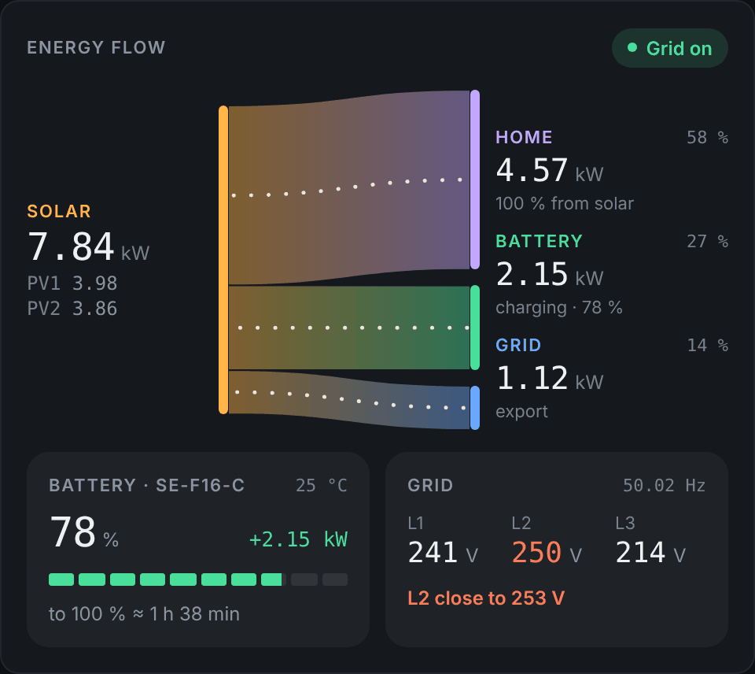 | 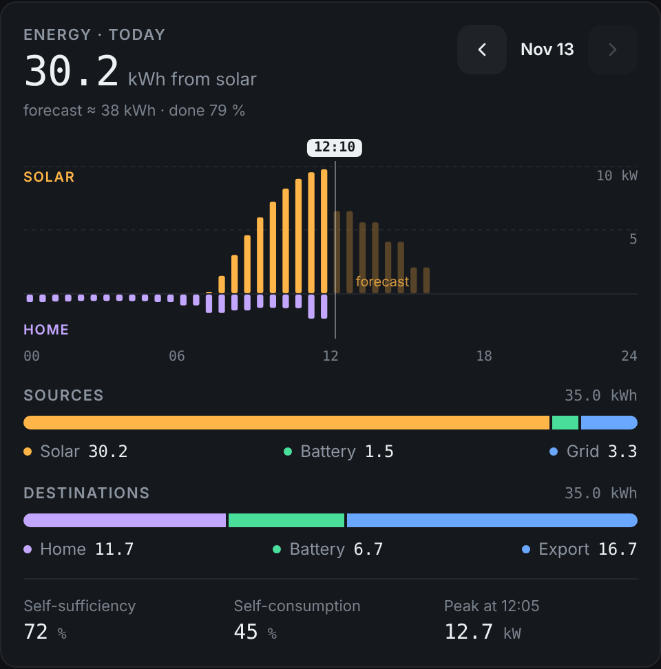 |

| Money                                                     | Light theme                                                          | Ukrainian                                                             |
| --------------------------------------------------------- | -------------------------------------------------------------------- | --------------------------------------------------------------------- |
| 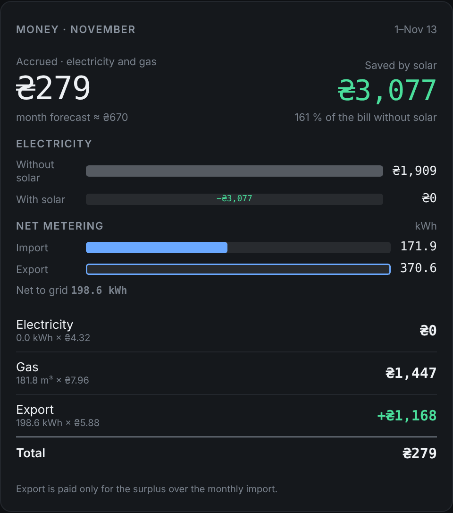 | 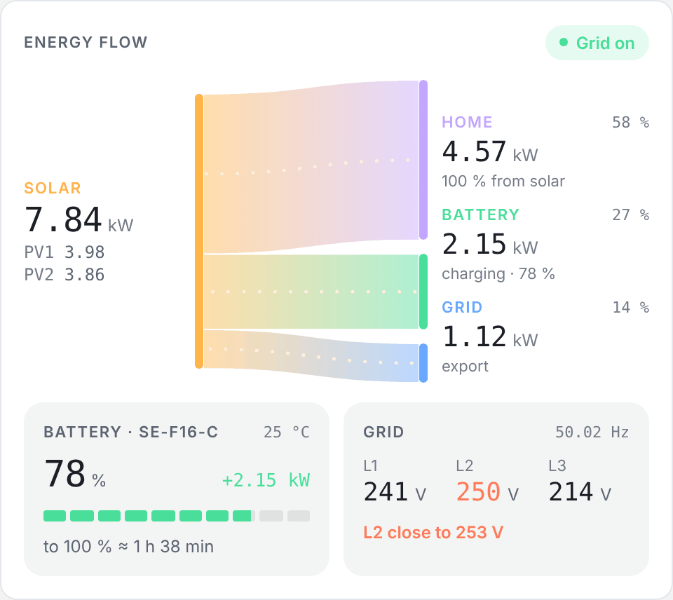 | 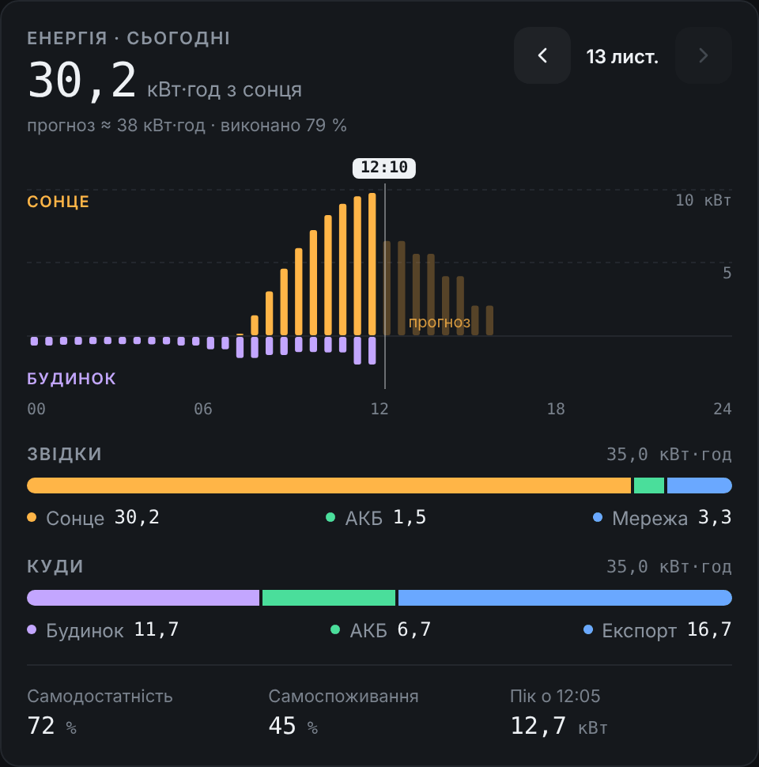 |

## Features

- **Works with what you have.** Statistics cards read the Home Assistant energy dashboard, so a
  configured dashboard is enough; any sensor can be set or overridden per card.
- **Long-term statistics.** History comes from recorder statistics: daily meters and lifetime
  counters both work, units are converted (W/kW, Wh/kWh/MWh, m³/L/ft³) and the ongoing hour is
  added from the live state.
- **Theme-aware.** Text and backgrounds follow the active theme; the accent colors can be changed
  per card or globally from a theme.
- **Translated.** English and Ukrainian, chosen from the Home Assistant language or per card; any
  text can be replaced with `labels`.
- **Visual editor.** Every card has a form editor; lists of entities use the object editor.

## Installation

### HACS

1. Open HACS → three dots → **Custom repositories**.
2. Add `https://github.com/RobinCK/lovelace-metron` with type **Dashboard**.
3. Install **Metron** and reload the browser.

### Manual

1. Download `metron.js` from the latest release.
2. Copy it to `config/www/metron.js`.
3. Add a dashboard resource `/local/metron.js` with type **JavaScript module**.

## Common options

Every card accepts these options:

| Option     | Type            | Default           | Description                                                                |
| ---------- | --------------- | ----------------- | -------------------------------------------------------------------------- |
| `title`    | string \| false | translated title  | Card title. `false` hides the header text.                                 |
| `language` | `en` \| `uk`    | Home Assistant UI | Language of the card texts.                                                |
| `labels`   | map             | —                 | Override any text by its translation key, e.g. `flow.home: House`.         |
| `colors`   | map             | theme-aware       | `solar`, `home`, `battery`, `grid`, `gas`, `warning`, `cold`, `ok` colors. |

Colors can also be set globally from a theme with `metron-solar-color`, `metron-home-color`,
`metron-battery-color`, `metron-grid-color`, `metron-gas-color`, `metron-warning-color`,
`metron-cold-color` and `metron-ok-color`.

Power sensors may report W or kW, energy sensors Wh, kWh or MWh, gas m³, L or ft³ — values are
converted automatically.

## Cards

| Card              | Type                            | What it shows                                                           |
| ----------------- | ------------------------------- | ----------------------------------------------------------------------- |
| Energy flow       | `metron-flow-card`              | Live power flows, battery and grid panels, autonomy during an outage    |
| Status chips      | `metron-status-card`            | A compact row of key values with bars and phase marks                   |
| Tiles             | `metron-tile-card`              | Entity tiles with hourly sparklines                                     |
| Live power        | `metron-live-card`              | Minute bars for the last hour                                           |
| Consumers         | `metron-devices-card`           | Devices: power, energy today, run state, unaccounted                    |
| Energy day        | `metron-energy-day-card`        | Half-hour production and consumption of a day, sources and destinations |
| Metrics           | `metron-stats-card`             | Self-consumption, self-sufficiency, net grid with comparison            |
| Month history     | `metron-history-card`           | Daily energy of a month by source                                       |
| Year by months    | `metron-year-card`              | Monthly generation, consumption and net balance                         |
| Period comparison | `metron-week-compare-card`      | This week against last week, metric by metric                           |
| Daily calendar    | `metron-calendar-card`          | A month of self-sufficiency rings with outage marks                     |
| Load profile      | `metron-profile-card`           | Weekday × hour heatmap of the load                                      |
| Solar year        | `metron-solar-year-card`        | A year of daily solar production                                        |
| Gas               | `metron-gas-card`               | Gas of the month with temperatures, degree-days and the boiler          |
| Heating season    | `metron-season-card`            | Cumulative season gas against last season with a forecast               |
| Money             | `metron-money-card`             | The bill of the month, net metering and savings                         |
| Tariff zones      | `metron-tariff-card`            | Your import priced on time-of-use plans                                 |
| Monthly limit     | `metron-budget-card`            | Import, consumption or gas against a monthly budget                     |
| Losses            | `metron-losses-card`            | Energy lost in stabilizers, inverters and battery cycles                |
| Solar forecast    | `metron-forecast-card`          | Forecast days, the typical load and the surplus window                  |
| Forecast accuracy | `metron-forecast-accuracy-card` | Forecast against actual production                                      |
| Week ahead        | `metron-week-ahead-card`        | Weather, solar, gas and outages for seven days                          |
| Sun and sky       | `metron-sky-card`               | The sun path, clouds by hour and day length                             |
| Day clock         | `metron-clock-card`             | Production and consumption on a 24-hour dial                            |
| PV strings        | `metron-strings-card`           | Strings against the median with repeating dips                          |
| Base load         | `metron-baseload-card`          | The night minimum, step changes and what it is made of                  |
| Nights on battery | `metron-nights-card`            | Evening charge, overnight minimum and night import                      |
| Load duration     | `metron-duration-card`          | Hours at each load level and phase peaks                                |
| Normal corridor   | `metron-corridor-card`          | Today against the usual range of the same weekday                       |
| Solar expansion   | `metron-expansion-card`         | A year model of more panels or a bigger battery                         |

All types are used as `custom:<type>`, e.g. `type: custom:metron-flow-card`.

### Energy flow — `custom:metron-flow-card`

 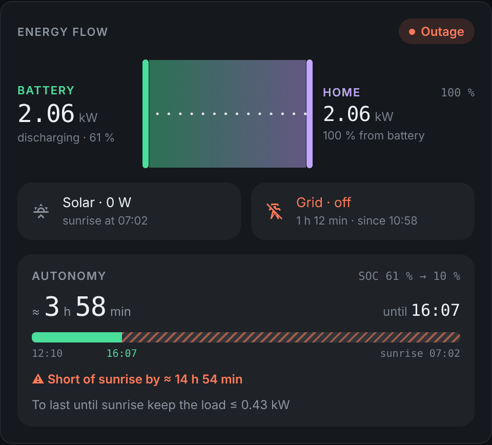

Power flows between solar, grid, battery and home as a Sankey diagram. With the grid on it shows
battery and grid panels; during an outage it switches to battery autonomy with the time left, the
shortfall until sunrise and the load that would get you there.

```yaml
type: custom:metron-flow-card
solar: sensor.deye_pv_power
grid: sensor.deye_grid_power
battery: sensor.deye_battery_power
battery_soc: sensor.deye_battery_soc
home: sensor.deye_load_power
grid_status: binary_sensor.deye_grid_connected
battery_capacity: 16
battery_reserve: 10
battery_name: SE-F16-C
battery_temperature: sensor.deye_battery_temperature
solar_strings:
  - sensor.deye_pv1_power
  - sensor.deye_pv2_power
grid_frequency: sensor.deye_grid_frequency
grid_voltages:
  - sensor.grid_l1_voltage
  - sensor.grid_l2_voltage
  - sensor.grid_l3_voltage
```

| Option                | Default   | Description                                                                  |
| --------------------- | --------- | ---------------------------------------------------------------------------- |
| `solar`               | —         | Solar power.                                                                 |
| `grid`                | —         | Grid power, positive = import.                                               |
| `battery`             | —         | Battery power, positive = discharge.                                         |
| `home`                | derived   | Home power. Derived from the balance when omitted.                           |
| `battery_soc`         | —         | Battery state of charge, %.                                                  |
| `invert_grid`         | `false`   | Flip the grid sign if your sensor reports export as positive.                |
| `invert_battery`      | `false`   | Flip the battery sign if your sensor reports charge as positive.             |
| `grid_status`         | —         | Binary sensor / switch that is `on` while the grid is present.               |
| `invert_grid_status`  | `false`   | Use when the sensor is `on` during an outage.                                |
| `battery_capacity`    | —         | Usable capacity, kWh. Enables time to full / reserve and autonomy.           |
| `battery_reserve`     | `10`      | Reserve SOC, %.                                                              |
| `battery_name`        | —         | Shown in the battery panel title.                                            |
| `battery_temperature` | —         | Battery temperature sensor.                                                  |
| `solar_strings`       | —         | List of string power sensors (`entity`, optional `name`).                    |
| `grid_frequency`      | —         | Grid frequency sensor.                                                       |
| `grid_voltages`       | —         | List of phase voltage sensors (`entity`, optional `name`).                   |
| `voltage_min` / `max` | `207/253` | Allowed voltage range; values within `voltage_margin` (5 V) are highlighted. |
| `sun`                 | `sun.sun` | Sun entity for sunrise / sunset.                                             |
| `height`              | `216`     | Maximum Sankey height, px.                                                   |
| `animate`             | `true`    | Animated dots along the flows.                                               |
| `show_panels`         | `true`    | Battery and grid panels below the diagram.                                   |

### Status chips — `custom:metron-status-card`

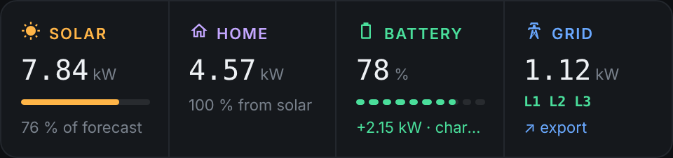

A compact strip of entities. Each chip can show a progress bar, battery segments, phase marks and
a secondary line.

```yaml
type: custom:metron-status-card
chips:
  - entity: sensor.deye_pv_power
    name: Solar
    color: solar
    progress: sensor.deye_day_pv_energy
    progress_max: sensor.solar_forecast_today
    secondary: '{percent} % of forecast'
  - entity: sensor.deye_load_power
    color: home
  - entity: sensor.deye_battery_soc
    color: battery
    power: sensor.deye_battery_power
  - entity: sensor.deye_grid_power
    color: grid
    direction: true
    phases:
      - binary_sensor.grid_l1
      - binary_sensor.grid_l2
      - binary_sensor.grid_l3
```

Chip and tile options:

| Option            | Description                                                                               |
| ----------------- | ----------------------------------------------------------------------------------------- |
| `entity`          | Main entity (required).                                                                   |
| `name` / `icon`   | Defaults to the entity name and icon.                                                     |
| `color`           | `solar`, `home`, `battery`, `grid`, `gas`, `warn`, `cold`, `ok` or any CSS color.         |
| `invert`          | Flip the sign of the value.                                                               |
| `digits`          | Fixed number of decimals.                                                                 |
| `secondary`       | Entity (shown as value) or text. `{percent}` is replaced with the progress percentage.    |
| `secondary_label` | Prefix for an entity secondary line, e.g. `outside`.                                      |
| `power`           | Battery power entity: shows `+2.46 kW · charging` (positive = discharge, `invert_power`). |
| `direction`       | Treat the value as signed grid power: shows the absolute value and import / export.       |
| `progress`        | Entity or number. Alone it is a percentage; with `progress_max` it is divided by the max. |
| `progress_max`    | Entity or number used as the progress maximum.                                            |
| `progress_style`  | `bar` or `segments` (battery entities default to segments).                               |
| `phases`          | Phase entities: binary sensors or voltages, shown as colored L1 L2 L3.                    |
| `sparkline`       | Tiles only: 24 hourly bars for today from long-term statistics.                           |

Card options: `chips` (list), `min_width` (minimum chip width, px, default `104`).

### Tiles — `custom:metron-tile-card`

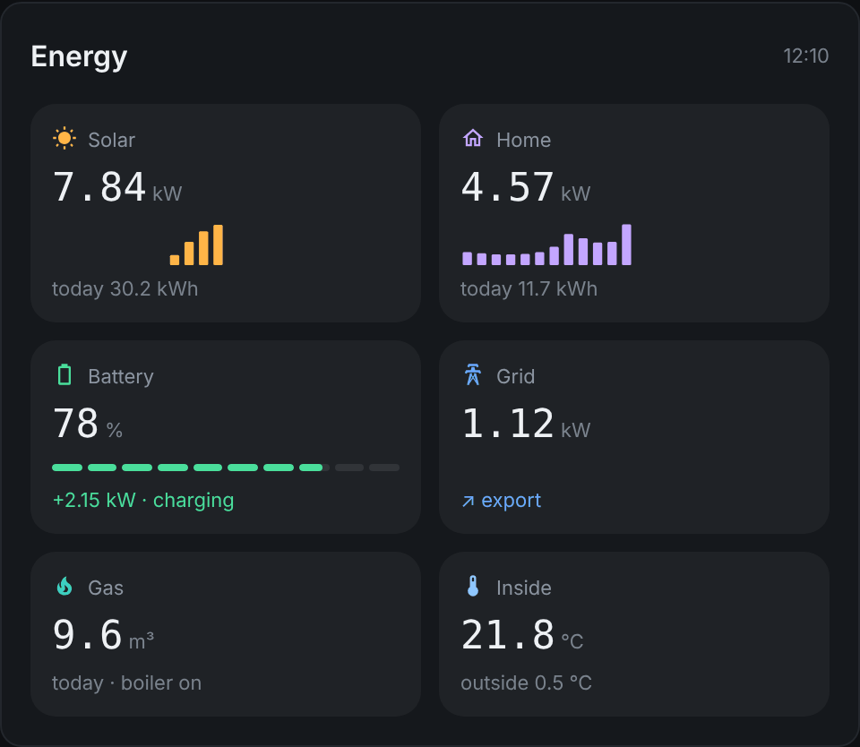

A grid of tiles using the same item options as the status chips.

```yaml
type: custom:metron-tile-card
title: Energy
show_time: true
columns: 2
tiles:
  - entity: sensor.deye_pv_power
    color: solar
    secondary: sensor.deye_day_pv_energy
    sparkline: true
  - entity: sensor.indoor_temperature
    color: cold
    secondary: sensor.outdoor_temperature
    secondary_label: outside
```

### Live power — `custom:metron-live-card`

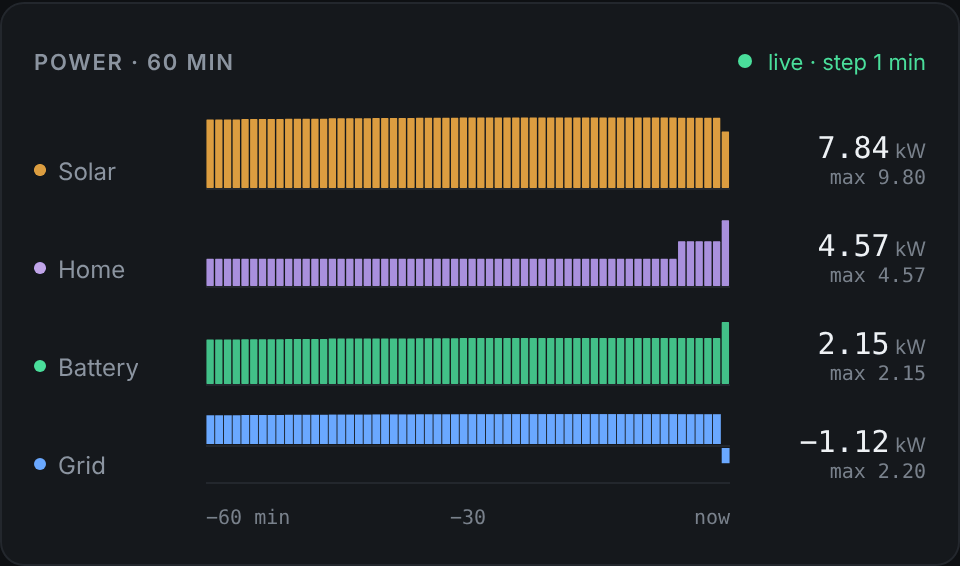

Bars for every step over the last minutes, the current value and the peak. Signed entities (grid,
battery) are drawn around a center line.

```yaml
type: custom:metron-live-card
minutes: 60
step: 1
entities:
  - entity: sensor.deye_pv_power
    color: solar
  - entity: sensor.deye_load_power
    color: home
  - entity: sensor.deye_battery_power
    color: battery
    invert: true
  - entity: sensor.deye_grid_power
    color: grid
```

Options: `entities` (`entity`, `name`, `color`, `invert`, `max`), `minutes` (`60`), `step`
(minutes per bar, `1`), `height` (row height, `36`).

### Consumers — `custom:metron-devices-card`

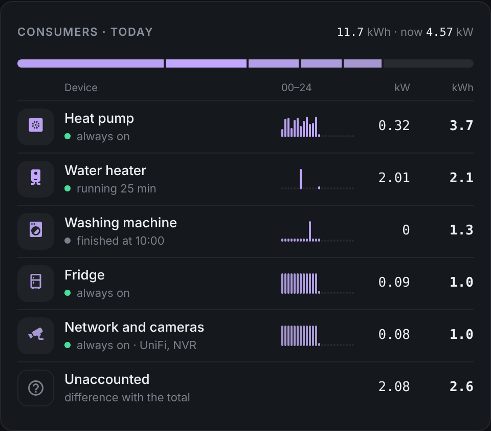

Power now and energy today per device, the share of each device, 24 hourly bars and a run state
(running for, always on, finished at, idle). With a total power or energy sensor the remainder is
shown as an unaccounted row.

```yaml
type: custom:metron-devices-card
total_power: sensor.deye_load_power
total_energy: sensor.deye_day_load_energy
devices:
  - name: Water heater
    power: sensor.boiler_power
    energy: sensor.boiler_energy
    icon: mdi:water-boiler
  - name: Washing machine
    power: sensor.washer_power
    cycle: true
  - name: Network
    power: sensor.network_power
    note: UniFi, NVR
```

| Option             | Default  | Description                                                                         |
| ------------------ | -------- | ----------------------------------------------------------------------------------- |
| `devices`          | —        | `name`, `power`, `energy`, `icon`, `color`, `threshold`, `status`, `note`, `cycle`. |
| `total_power`      | —        | House power sensor for the header and the unaccounted row.                          |
| `total_energy`     | —        | House energy sensor (any counter) for the unaccounted row.                          |
| `threshold`        | `10`     | Power above which a device counts as running, W.                                    |
| `sort`             | `energy` | `energy`, `power` or `none`.                                                        |
| `sparkline`        | `true`   | Hourly bars for today.                                                              |
| `show_unaccounted` | `true`   | Show the remainder when a total is configured.                                      |

Energy today comes from long-term statistics, so lifetime counters and daily meters both work.
Without an energy sensor the energy is integrated from 5-minute power statistics. A `status`
entity replaces the run state text, `cycle: true` shows when the last run finished.

### Energy sensors for statistics cards

Cards that work with history read **long-term statistics** of energy counters. Every option takes
one entity or a list. Anything you leave out is taken from the Home Assistant **energy dashboard**
(`energy_dashboard: false` turns this off), so with a configured energy dashboard these cards work
without any options.

| Option                     | Description                                                       |
| -------------------------- | ----------------------------------------------------------------- |
| `solar_energy`             | Solar production counter(s).                                      |
| `home_energy`              | Home consumption counter(s). Derived from the balance if omitted. |
| `grid_import_energy`       | Energy taken from the grid.                                       |
| `grid_export_energy`       | Energy sent to the grid.                                          |
| `battery_charge_energy`    | Energy into the battery.                                          |
| `battery_discharge_energy` | Energy out of the battery.                                        |
| `energy_dashboard`         | Fill missing sources from the energy dashboard. Default `true`.   |

Counters can be daily meters or lifetime totals. The ongoing hour is added from the live state.

### Energy day — `custom:metron-energy-day-card`


Half-hour production above the axis and consumption below it, the solar forecast for the rest of
the day, where the energy came from and where it went, self-sufficiency, self-consumption and the
solar peak. Arrows switch days.

```yaml
type: custom:metron-energy-day-card
solar_power: sensor.deye_pv_power
home_power: sensor.deye_load_power
```

| Option                  | Default | Description                                                                |
| ----------------------- | ------- | -------------------------------------------------------------------------- |
| `solar_power`           | —       | Power sensor for the half-hour profile and the peak (5-minute statistics). |
| `home_power`            | —       | Power sensor for the consumption profile.                                  |
| `solar_forecast`        | `auto`  | `auto` uses the energy dashboard forecast, `off` hides it.                 |
| `solar_forecast_entity` | —       | Sensor with today's forecast in kWh for the summary line.                  |
| `slot_minutes`          | `30`    | `30` or `60`.                                                              |
| `navigation`            | `true`  | Day arrows.                                                                |

Without power sensors the profile is built from hourly energy.

### Metrics — `custom:metron-stats-card`

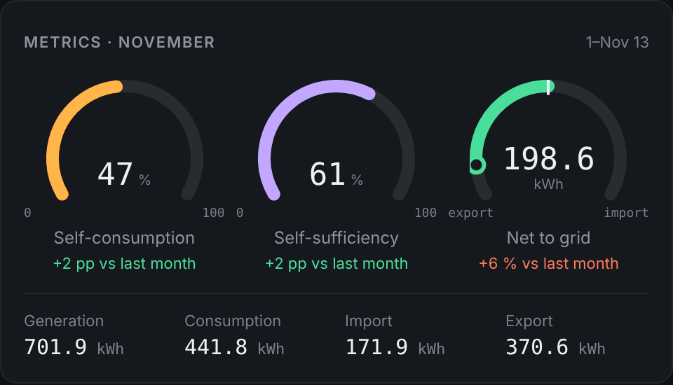

Self-consumption, self-sufficiency and the net grid balance as gauges, with totals and a
comparison with the same part of the previous period.

```yaml
type: custom:metron-stats-card
period: month
```

Options: `period` (`day`, `week`, `month`, `year`; default `month`), `compare` (`true`).

### Month history — `custom:metron-history-card`

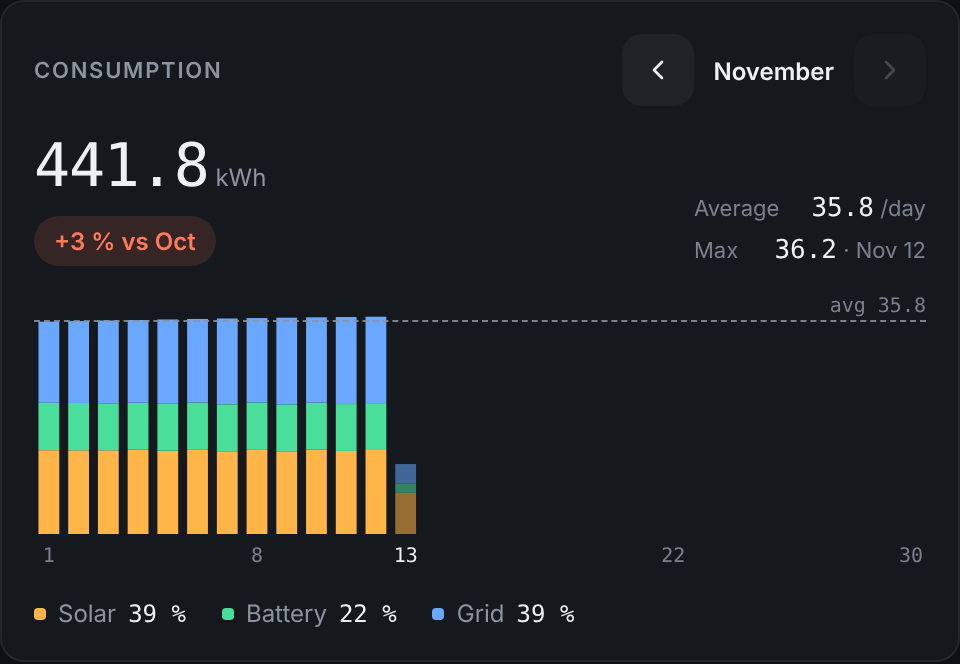

Daily bars for a month split by source (solar, battery, grid), the average line, the maximum and
the change against the previous month. `mode: production` splits solar production into self-used,
battery and export instead.

Options: `mode` (`consumption` / `production`), `navigation` (`true`), `height` (`120`).

### Year by months — `custom:metron-year-card`

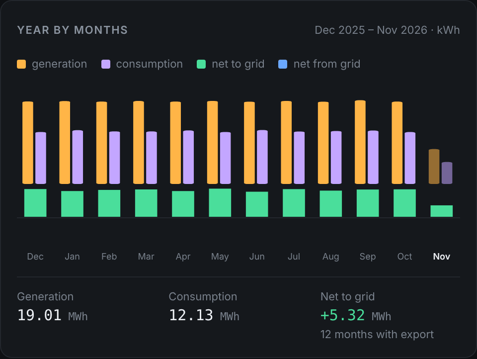

Generation and consumption per month for the last year and the net grid balance per month.

Options: `months` (`12`), `height` (`100`).

### Period comparison — `custom:metron-week-compare-card`

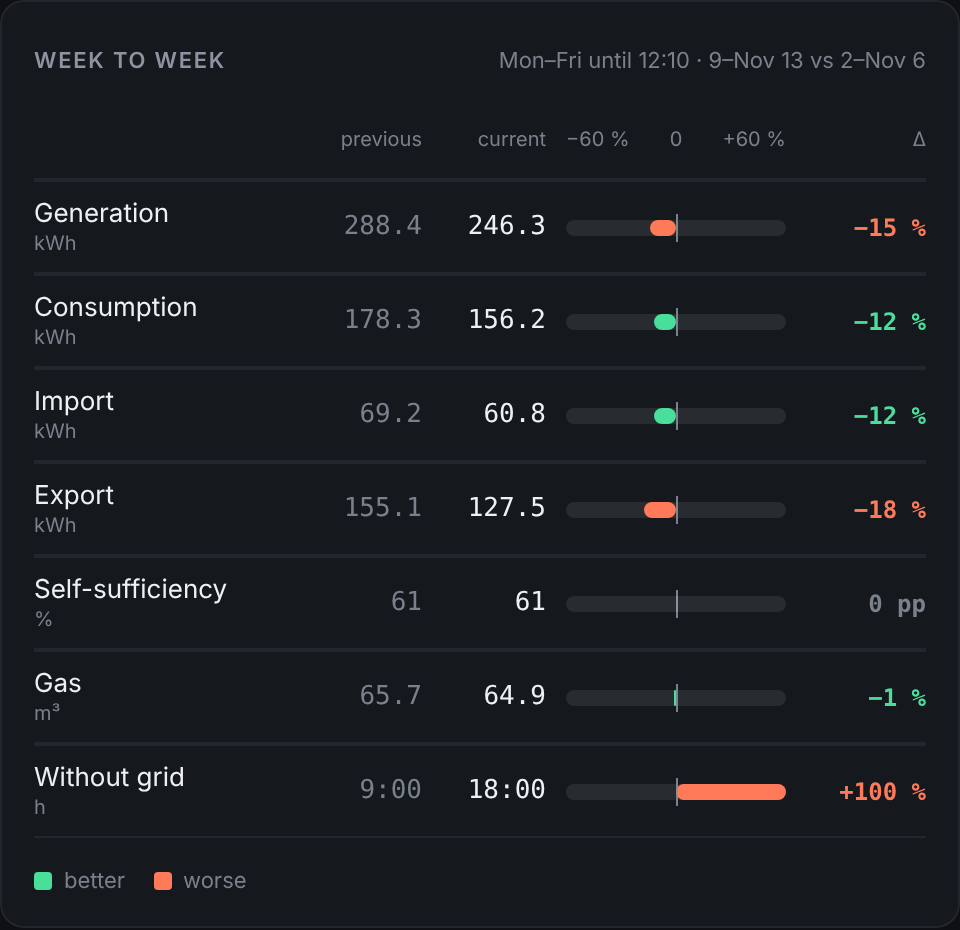

This week until now against the same span of last week, as rows with a diverging bar per metric.

```yaml
type: custom:metron-week-compare-card
period: week
gas: sensor.gas_meter
grid_status: binary_sensor.deye_grid_connected
metrics: [generation, consumption, import, export, self_sufficiency, gas, outage]
```

Options: `period` (`day`, `week`, `month`, `year`), `metrics` (any of `generation`, `consumption`,
`import`, `export`, `self_sufficiency`, `self_consumption`, `gas`, `outage`), `gas` (gas counter),
`grid_status` and `invert_grid_status` (for hours without grid), `scale` (bar scale, %, `60`).

### Daily calendar — `custom:metron-calendar-card`

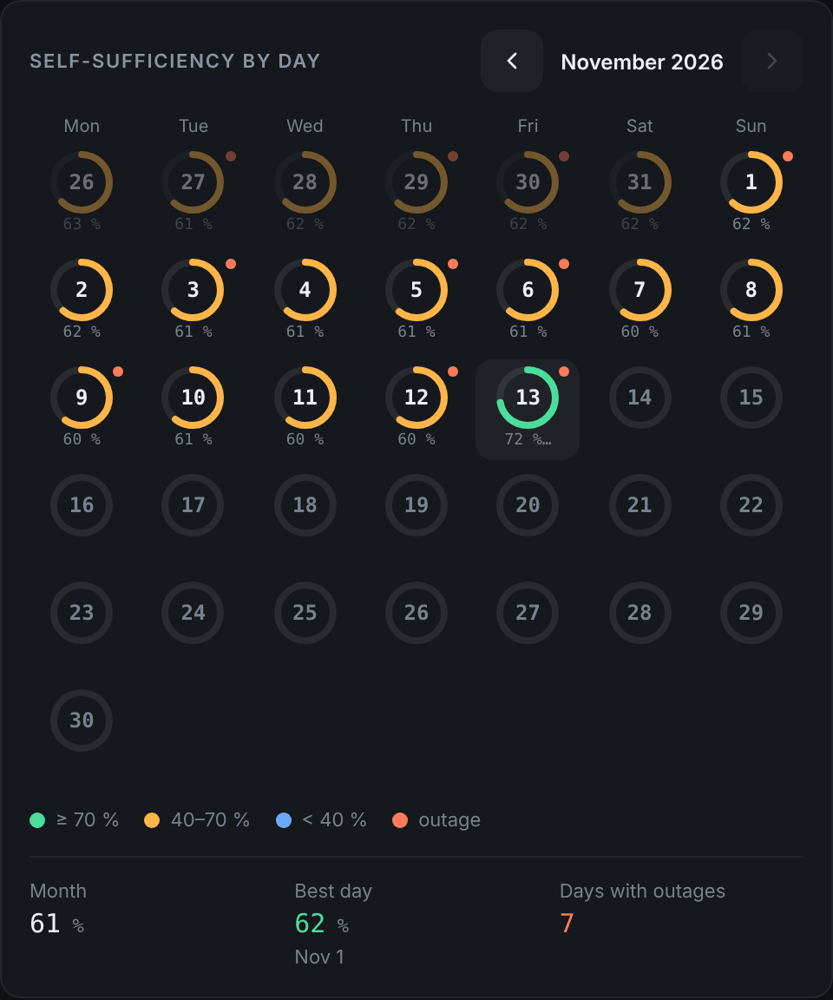

A month calendar with a ring per day. Self-sufficiency is colored by level; energy metrics are
relative to the best day of the month. With `grid_status` days with outages get a mark.

Options: `metric` (`self_sufficiency`, `self_consumption`, `solar`, `home`, `import`, `export`),
`high` / `low` (`70` / `40`), `grid_status`, `invert_grid_status`, `navigation`, `first_weekday`
(`1` = Monday, `0` = Sunday).

### Load profile — `custom:metron-profile-card`

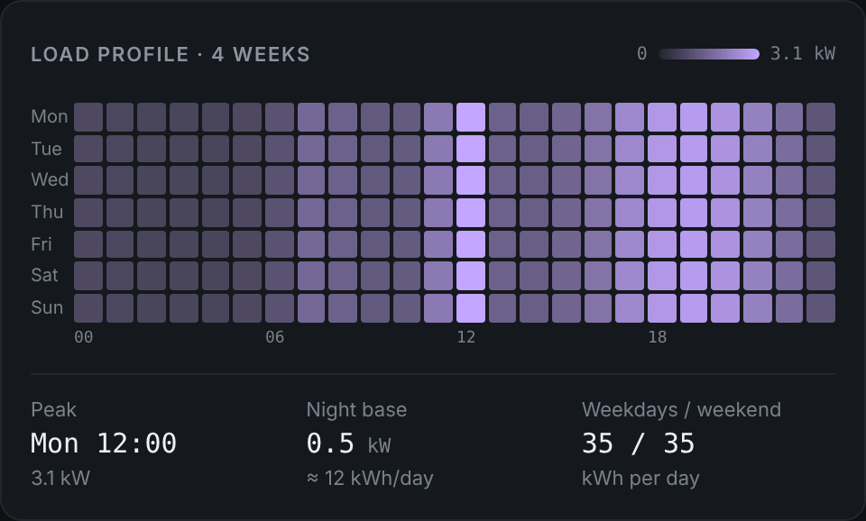

Average power by weekday and hour over the last weeks, the peak, the night base load and the
average daily consumption on weekdays and weekends.

Options: `entity` (power sensor or energy counter; home consumption from the energy sensors when
omitted), `weeks` (`4`), `color`, `night_start` / `night_end` (`1` / `5`), `first_weekday`.

### Solar year — `custom:metron-solar-year-card`

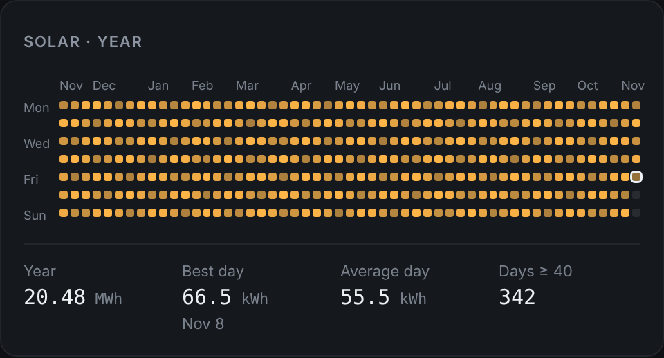

A year of daily solar production as a calendar heatmap with the year total, the best and the
average day.

Options: `entity` (solar energy counter; energy sensors when omitted), `weeks` (`53`), `good_day`
(kWh, counts the days above it), `max` (kWh for the full color), `color`, `first_weekday`.

### Gas — `custom:metron-gas-card`

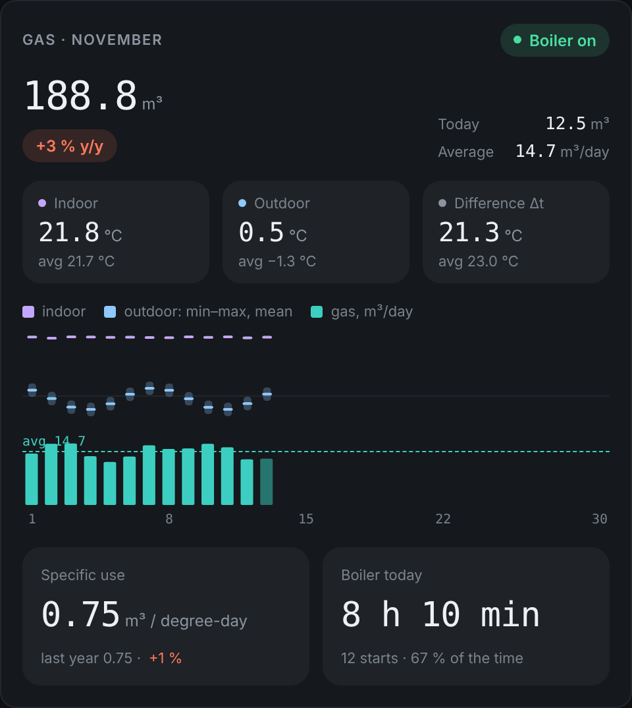

Gas this month with the year-over-year change, today and the daily average, indoor and outdoor
temperatures, daily bars, specific use per degree-day and the boiler run time today.

```yaml
type: custom:metron-gas-card
gas: sensor.gas_meter
indoor: sensor.indoor_temperature
outdoor: sensor.outdoor_temperature
boiler: binary_sensor.boiler_heating
```

Options: `gas` (gas counter(s); the energy dashboard gas source when omitted), `indoor`, `outdoor`
(temperature sensors with statistics), `boiler` (binary sensor, switch or climate), `base_temperature`
(degree-day base, `18` °C), `compare` (year over year, `true`), `energy_dashboard`.

### Heating season — `custom:metron-season-card`

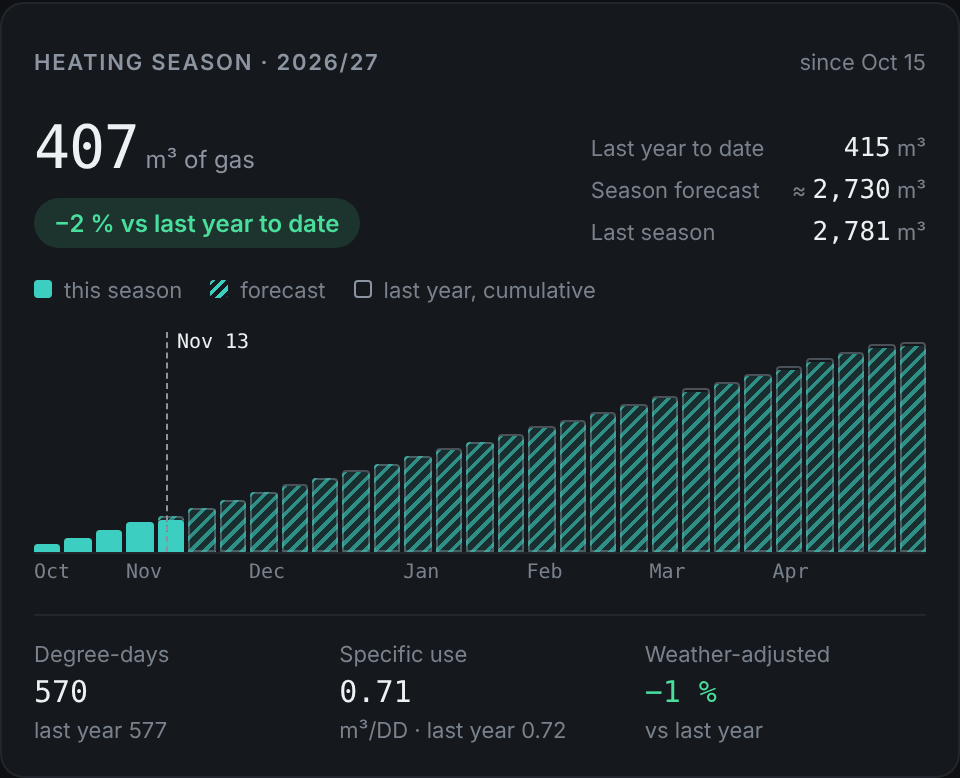

Cumulative gas for the heating season by week against last season, a forecast for the rest of
the season scaled by how this season compares so far, degree-days and weather-adjusted use.

Options: `gas`, `outdoor`, `base_temperature` (`18`), `season_start` (`10-15`), `season_end`
(`04-30`), `energy_dashboard`.

### Money — `custom:metron-money-card`


The bill of the month so far and its forecast, savings from solar against a bill without it,
monthly net metering of import and export, and the lines of the bill.

```yaml
type: custom:metron-money-card
electricity_price: 4.32
export_price: 5.88
gas_price: 7.96
gas: sensor.gas_meter
```

| Option              | Default         | Description                                                  |
| ------------------- | --------------- | ------------------------------------------------------------ |
| `electricity_price` | —               | Price per kWh: a number or a price sensor.                   |
| `export_price`      | —               | Price paid per exported kWh.                                 |
| `gas_price`         | —               | Price per m³; adds the gas line.                             |
| `netting`           | `true`          | Bill only the monthly net: import − export, export − import. |
| `currency`          | system currency | ISO code, e.g. `UAH`, `EUR`.                                 |
| `note`              | —               | Footnote text.                                               |

### Tariff zones — `custom:metron-tariff-card`

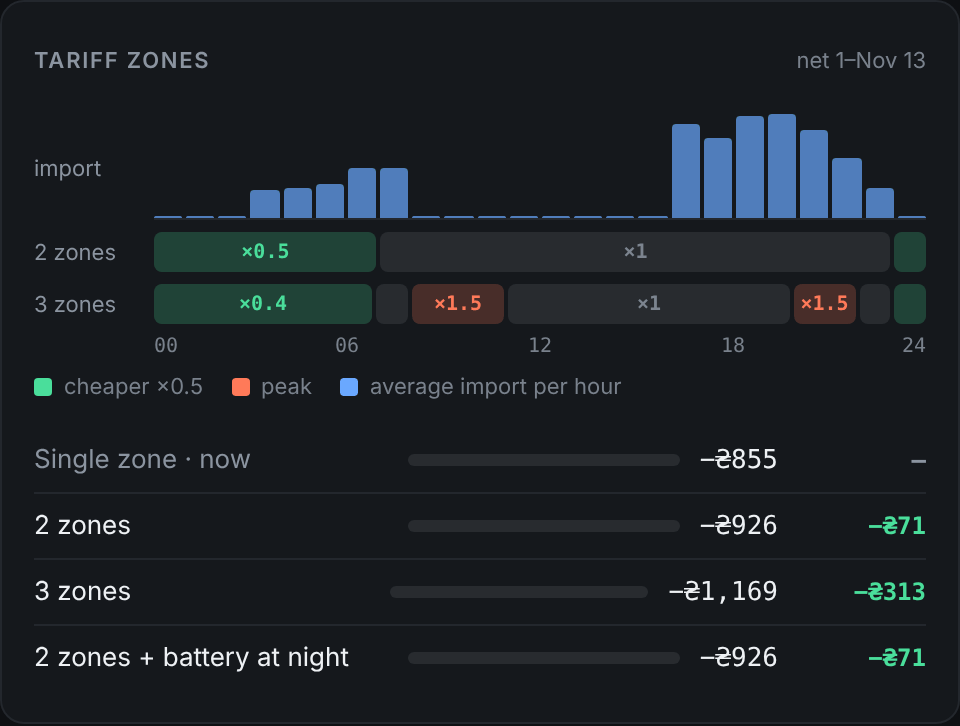

What the net import of the period would cost on time-of-use plans compared with the single-zone
price, plus a scenario that charges the battery in the cheap zone. Ukrainian two- and three-zone
plans are the default.

```yaml
type: custom:metron-tariff-card
price: 4.32
plans:
  - name: Two zones
    zones:
      - { from: '23:00', to: '07:00', factor: 0.5 }
  - name: Three zones
    zones:
      - { from: '23:00', to: '07:00', factor: 0.4 }
      - { from: '08:00', to: '11:00', factor: 1.5 }
      - { from: '20:00', to: '22:00', factor: 1.5 }
```

Options: `price`, `plans`, `battery_shift` (`true`), `shift_loss` (%, `10`), `period` (`month`),
`currency`.

### Monthly limit — `custom:metron-budget-card`

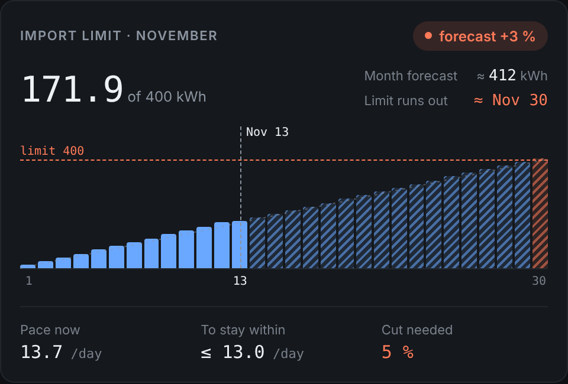

Cumulative import, consumption or gas against a monthly budget, the forecast, the day the limit
runs out and the daily pace needed to stay within it.

Options: `budget` (number or entity), `metric` (`import`, `consumption`, `gas`), `gas`, `height`.

### Losses — `custom:metron-losses-card`

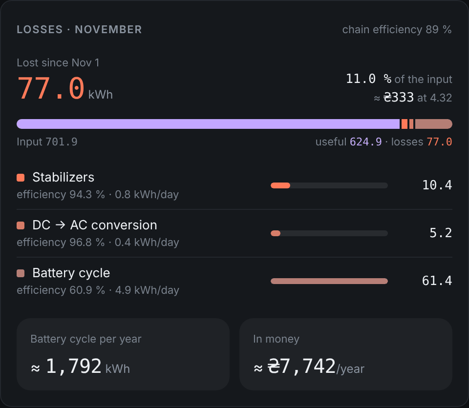

Energy lost in conversion stages, each defined by an input and an output energy counter, the
chain efficiency against a reference input and the cost of the losses.

```yaml
type: custom:metron-losses-card
input: sensor.deye_day_pv_energy
price: 4.32
stages:
  - name: Stabilizers
    input: sensor.stabilizer_in_energy
    output: sensor.stabilizer_out_energy
  - name: Battery cycle
    input: sensor.deye_day_battery_charge
    output: sensor.deye_day_battery_discharge
```

Options: `stages` (`name`, `input`, `output`, `color`), `input` (reference input; solar energy when
omitted), `price`, `currency`, `period` (`month`).

### Solar forecast — `custom:metron-forecast-card`

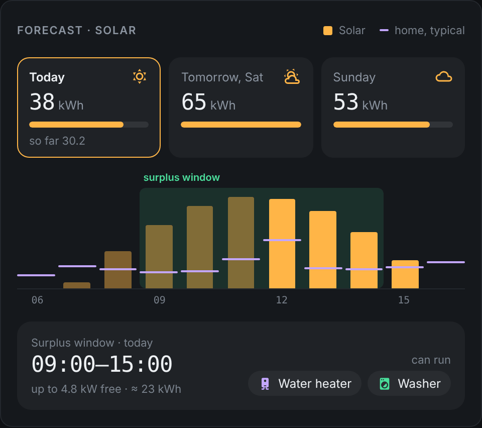

The solar forecast for the next days (from the energy dashboard forecast or daily forecast
sensors), the hourly forecast against the typical home load of recent weeks, the window with a
surplus and the appliances that fit into it.

```yaml
type: custom:metron-forecast-card
weather: weather.home
threshold: 1.5
appliances:
  - { name: Water heater, power: 2000, icon: mdi:water-boiler }
  - { name: Washing machine, power: 1900, icon: mdi:washing-machine }
```

Options: `weather` (icons per day), `days` (`3`), `threshold` (surplus, kW, `1.5`), `history_days`
(typical load, `14`), `forecast_entities` (daily totals: today, tomorrow, …), `appliances` (`name`,
`power` in W, `icon`). Hourly bars need the energy dashboard solar forecast.

### Forecast accuracy — `custom:metron-forecast-accuracy-card`

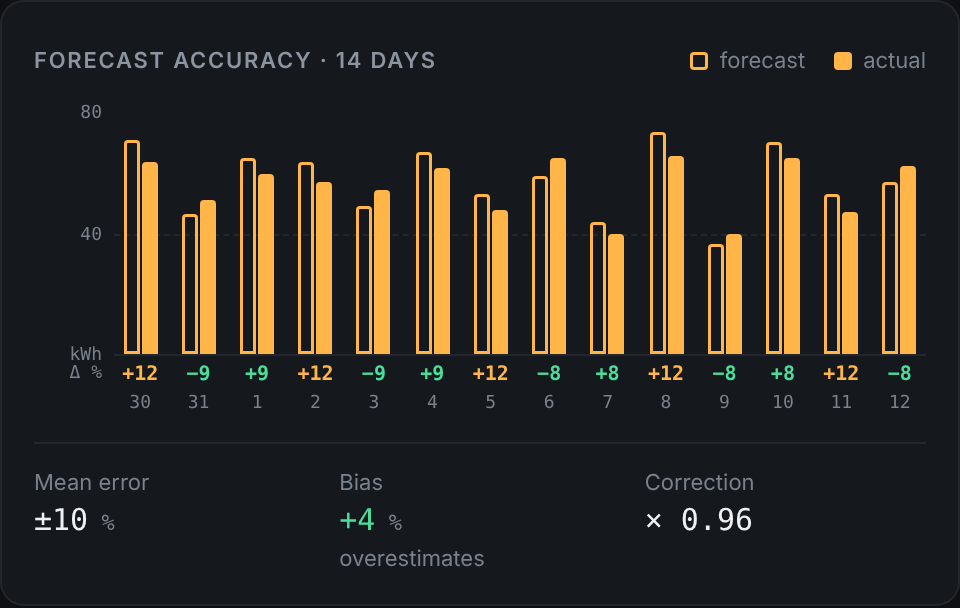

The daily forecast against actual production for the last days with the error per day, the mean
error, the bias and a correction factor.

```yaml
type: custom:metron-forecast-accuracy-card
forecast: sensor.energy_production_today
```

Options: `forecast` (required; a sensor with the forecast for the day), `offset` (`0` when the
sensor forecasts today, `1` when it forecasts tomorrow), `sample_time` (when to read the forecast,
`06:00`, or `21:00` the day before with `offset: 1`), `days` (`14`), `good` / `fair` (error levels,
`10` / `25` %).

### Week ahead — `custom:metron-week-ahead-card`

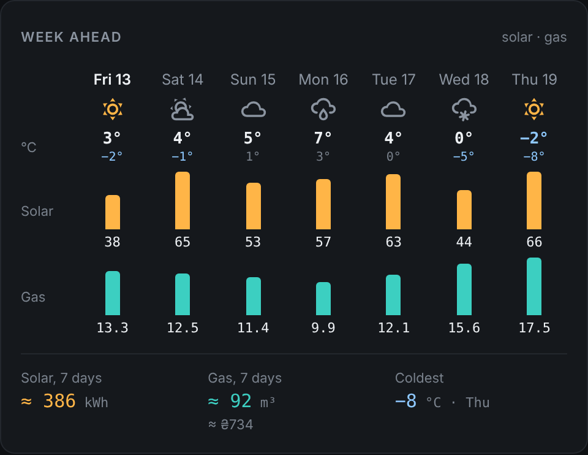

Seven days of weather with expected solar production, gas use estimated from degree-days and
planned outages from a calendar.

```yaml
type: custom:metron-week-ahead-card
weather: weather.home
gas: sensor.gas_meter
outdoor: sensor.outdoor_temperature
outage_calendar: calendar.outages
```

Options: `weather` (required), `days` (`7`), `clear_day` (kWh on a clear day; the best day of the
last 30 days by default), `gas`, `outdoor`, `base_temperature`, `gas_price`, `currency`,
`outage_calendar`. Days without a solar forecast are estimated from the weather condition and
marked with ≈.

### Sun and sky — `custom:metron-sky-card`

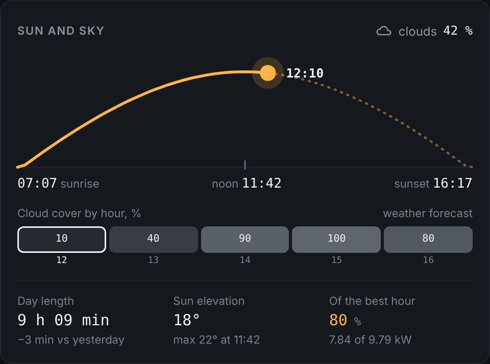

The sun path for today with sunrise, noon and sunset, cloud cover by hour, day length, sun
elevation and current solar power against the best value for this hour in the last 30 days.

Options: `weather` (cloud cover), `solar_power`, `latitude` / `longitude` (Home Assistant location
by default).

### Day clock — `custom:metron-clock-card`

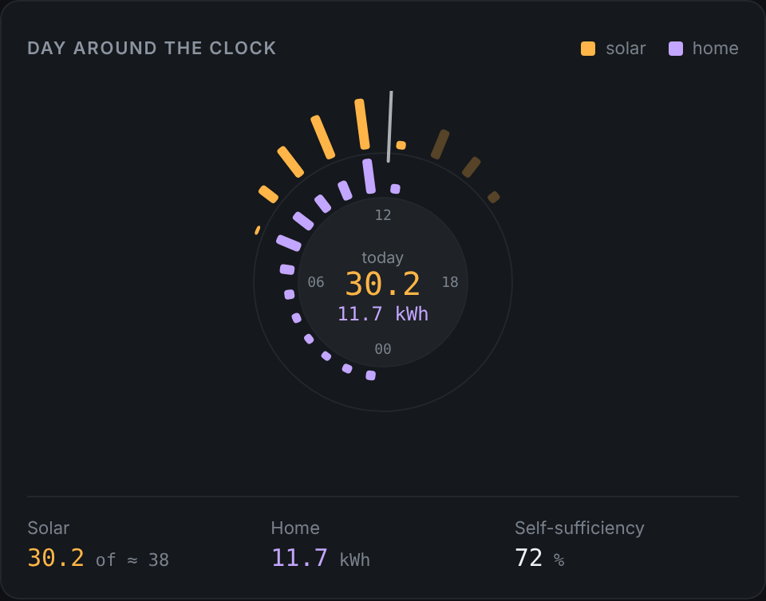

Hourly solar production (outer ring, forecast for the remaining hours) and home consumption
(inner ring) on a 24-hour dial with today's totals.

Options: `forecast` (`true`) and the energy sensors.

### PV strings — `custom:metron-strings-card`

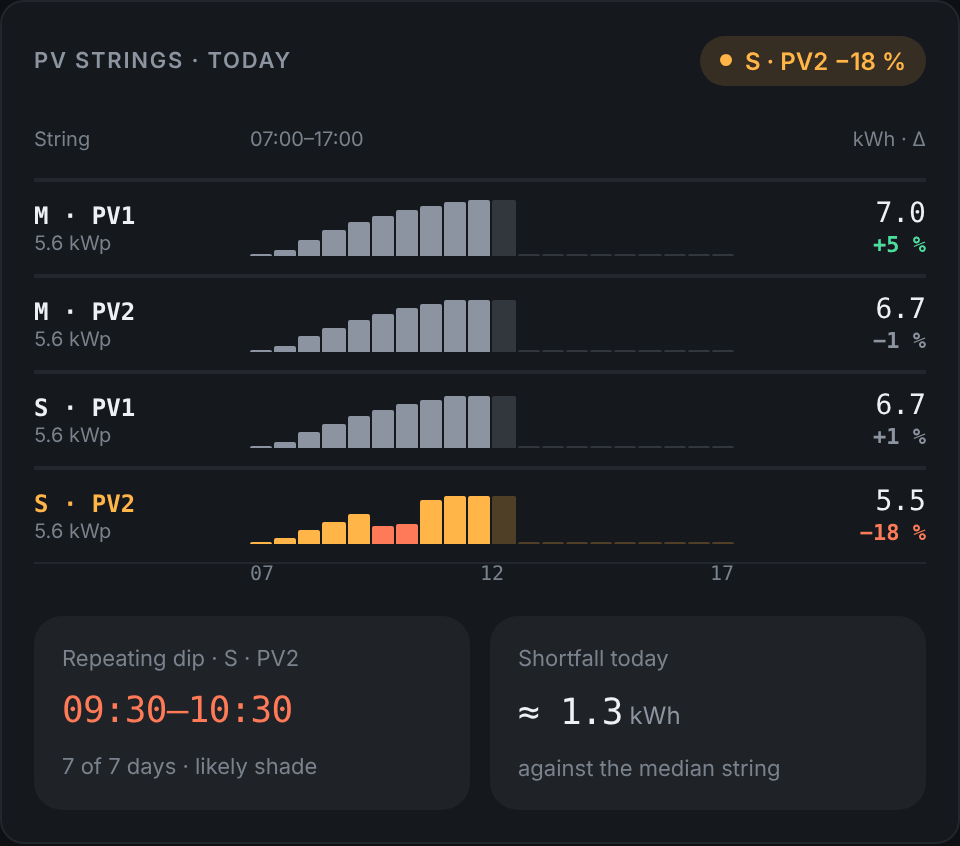

Per-string production today normalized by peak power and compared with the median string, plus
dips that repeat on most of the recent days at the same time — usually shade.

```yaml
type: custom:metron-strings-card
strings:
  - { entity: sensor.deye_master_pv1_power, name: M · PV1, peak_power: 5.6 }
  - { entity: sensor.deye_master_pv2_power, name: M · PV2, peak_power: 5.6 }
  - { entity: sensor.deye_slave_pv1_power, name: S · PV1, peak_power: 5.6 }
  - { entity: sensor.deye_slave_pv2_power, name: S · PV2, peak_power: 5.6 }
```

Options: `strings` (`entity`, `name`, `peak_power` in kWp), `from` / `to` (window, auto by default),
`dip` (% below the median, `25`), `days` (`7`, up to 9 because 5-minute statistics are kept for 10
days), `deviation` (flag threshold, `8` %).

### Base load — `custom:metron-baseload-card`

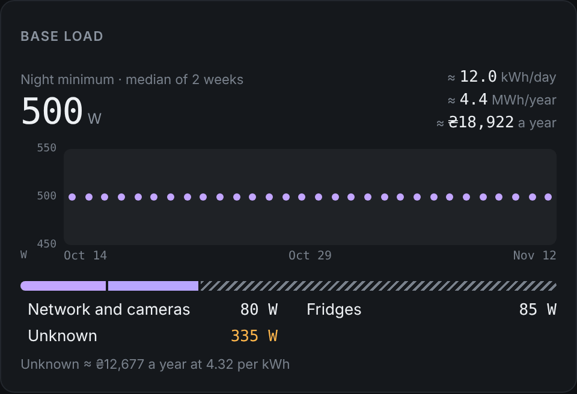

The night minimum of the house for every day, its median for the last two weeks, a step change
when the base load moved, what it costs a year and what it is made of when you list the known
always-on loads.

```yaml
type: custom:metron-baseload-card
entity: sensor.deye_load_power
price: 4.32
loads:
  - { entity: sensor.network_rack_power, name: Network and cameras }
  - { entity: sensor.fridge_power, name: Fridges }
```

Options: `entity` (home power or energy; home consumption from the energy sensors when omitted),
`days` (`30`), `night_start` / `night_end` (`01:00` / `05:00`), `loads` (`entity`, `name`, `color`),
`price`, `currency`, `step_threshold` (W, `40`).

### Nights on battery — `custom:metron-nights-card`

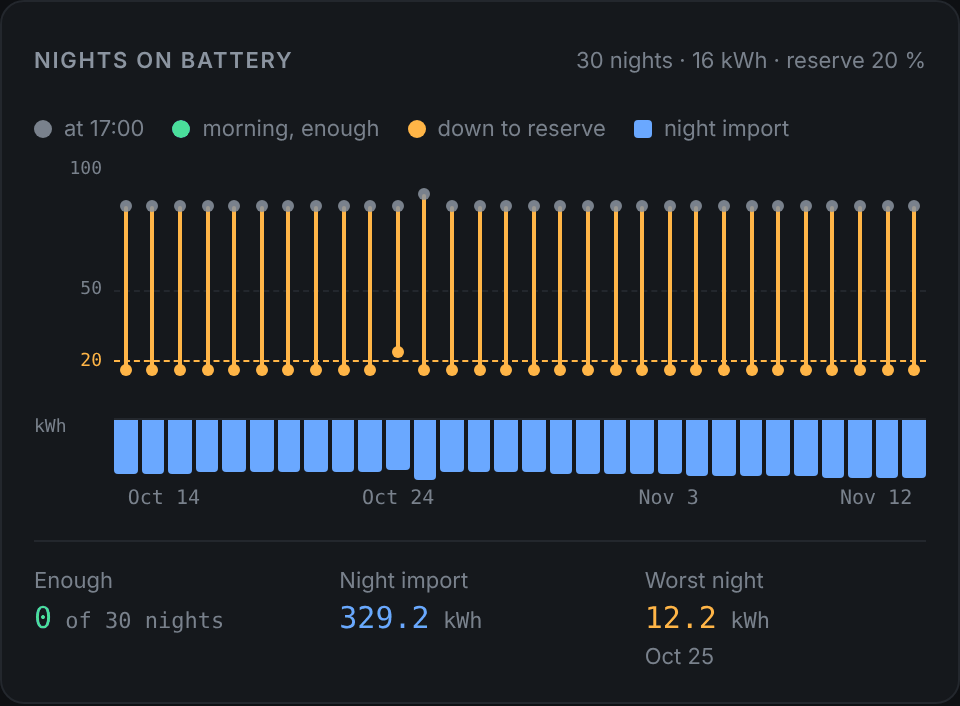

For every night: the battery charge in the evening, the lowest charge until the morning and the
grid import overnight, with how many nights the battery was enough.

```yaml
type: custom:metron-nights-card
battery_soc: sensor.deye_battery_soc
battery_capacity: 16
battery_reserve: 20
```

Options: `battery_soc` (required), `battery_capacity`, `battery_reserve` (`20`), `evening`
(`17:00`), `morning` (`07:00`), `days` (`30`) and the energy sensors for the import.

### Load duration — `custom:metron-duration-card`

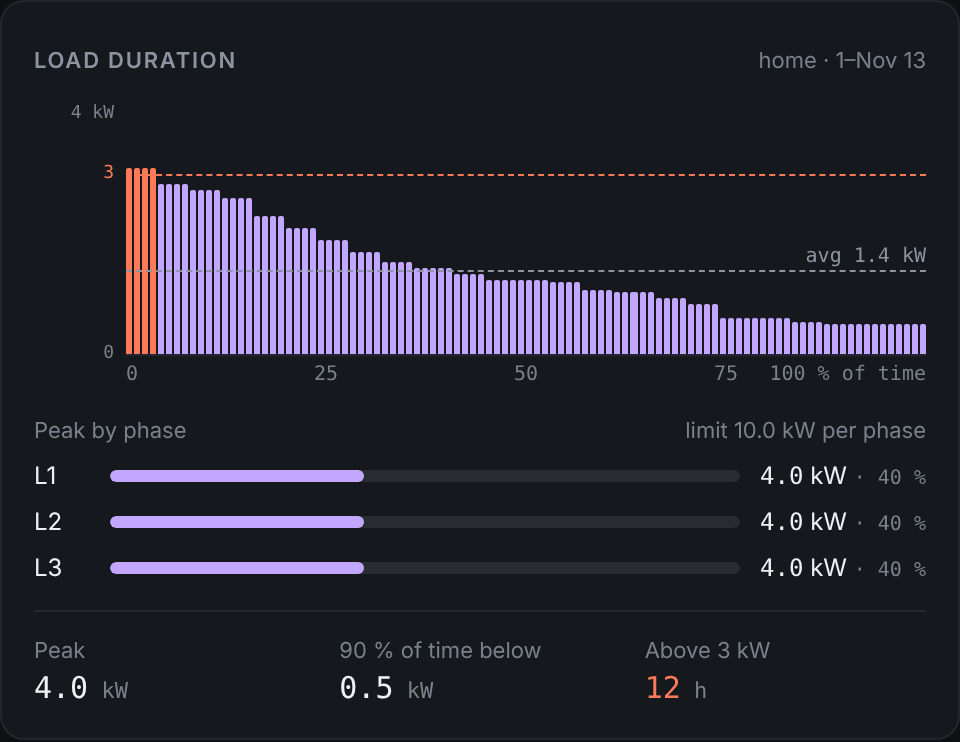

The hourly load sorted from the highest to the lowest: how many hours the house spends above a
level, the average, the value 90 % of the time stays below and the peak per phase against a limit.

```yaml
type: custom:metron-duration-card
entity: sensor.deye_load_power
threshold: 5
phase_limit: 10
phases:
  - sensor.deye_load_l1_power
  - sensor.deye_load_l2_power
  - sensor.deye_load_l3_power
```

Options: `entity`, `threshold` (kW, `5`), `phases`, `phase_limit` (kW per phase), `period`
(`month`).

### Normal corridor — `custom:metron-corridor-card`

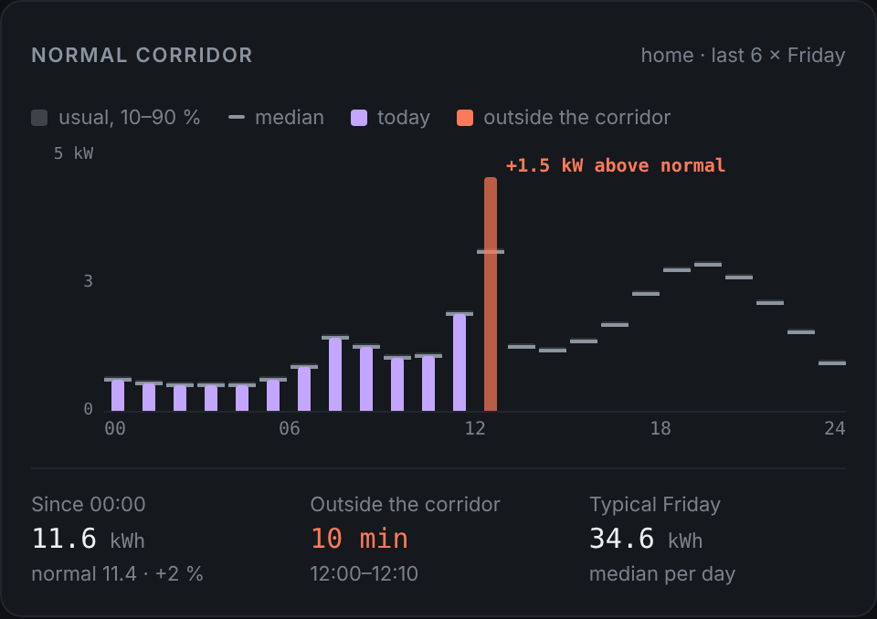

Today by hour against the usual range of the same weekday over the last weeks: the 10–90 %
corridor, the median, hours outside the corridor and the consumption since midnight against the
usual one.

Options: `entity` (power or energy; the live power fills the current hour), `weeks` (`6`), `low` /
`high` (percentiles, `10` / `90`), `same_weekday` (`true`).

### Solar expansion — `custom:metron-expansion-card`

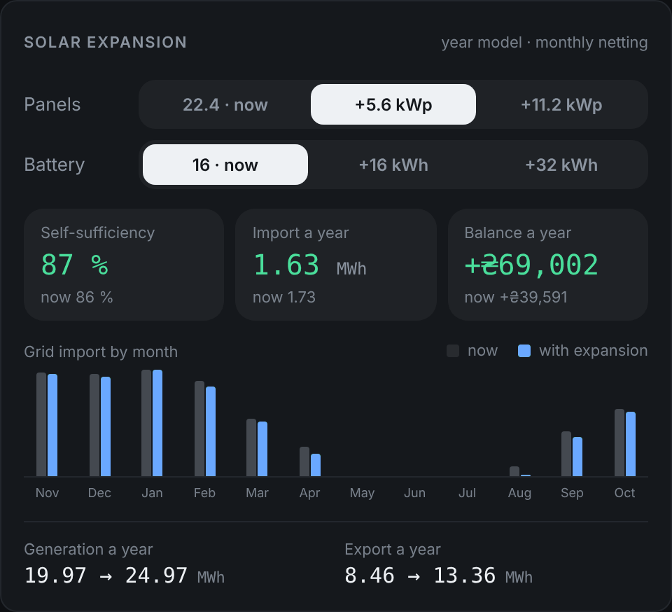

A model of the last twelve months with more panels or a bigger battery: an hourly simulation of
a typical day per month gives self-sufficiency, import, export and the yearly balance in money.

```yaml
type: custom:metron-expansion-card
pv_power: 22.4
battery_capacity: 16
pv_step: 5.6
battery_step: 16
price: 4.32
export_price: 5.88
```

Options: `pv_power` (current kWp, required), `battery_capacity`, `pv_step`, `battery_step`, `steps`
(`2`), `usable` (usable battery share, `80` %), `efficiency` (`95` %), `price`, `export_price`,
`netting` (`true`), `currency` and the energy sensors.

## Development

```bash
npm install
npm run build      # dist/metron.js
npm run lint
npm run typecheck
npm test
```

## License

MIT
